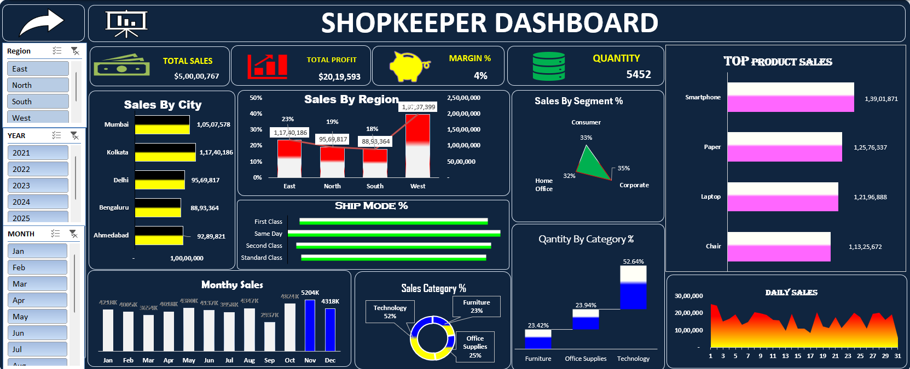

# 📊 Sales & Revenue Analytics Dashboard (Excel)

An interactive Excel dashboard that analyses **1,000 orders across India (2021 – 2025)**. It tracks sales, profit, quantity sold and performance by category, region, city, customer segment and shipping mode.

## 📂 Files in this repository

| File | Description |
|------|-------------|
| [`Sales_Revenue_Analytics_Dashboard.xlsx`](./Sales_Revenue_Analytics_Dashboard.xlsx) | Full Excel workbook (Data, Pivot Table and Dashboard sheets) |
| `dashboard-preview.png` | Screenshot of the dashboard |
| `README.md` | Project overview |

> GitHub cannot preview Excel dashboards. Click the file, use the **Download raw file** button and open it in Microsoft Excel to use the interactive slicers.

## 📊 Headline numbers

| Metric | Value |
|--------|-------|
| Total sales | **₹50.0 million** |
| Total profit | **₹2.02 million** |
| Profit margin | **4.04%** |
| Total quantity sold | **5,452 units** |

## 🔍 Key insights

1. **Technology is the biggest category.** It brings in about 52.6% of total sales (Smartphones and Laptops), while Office Supplies (23.9%) and Furniture (23.4%) share the rest almost equally.
2. **West region leads.** It contributes about 39.6% of sales, followed by East (23.5%), North (19.1%) and South (17.8%).
3. **Kolkata is the top city** with ₹11.7M in sales, followed by Mumbai (₹10.5M) and Delhi (₹9.6M). Bengaluru is the lowest at ₹8.9M.
4. **Seasonality:** November is the strongest month for sales (₹5.2M) and September the weakest (₹2.9M). Profit also peaks towards the end of the year, with December highest at about ₹200K.
5. **Year-wise trend:** 2024 was the best year (₹11.1M). Sales dipped to ₹9.1M in 2023 before recovering.
6. **Customer segments are balanced:** Corporate (34.8%), Consumer (33.3%) and Home Office (31.9%).
7. **Shipping:** Same Day is the most used shipping mode (27.3% of sales).
8. **Low margin:** the profit margin is only about 4%, which suggests discounts are eating into profit and is worth reviewing.

## 🛠️ Tools & techniques used

- Microsoft Excel
- Pivot Tables and Pivot Charts
- Slicers for interactive filtering
- Data cleaning and preparation (Year, Month and Day columns)
- KPI cards and dashboard design

## 👤 Author

**Sunny Pawar** — [GitHub](https://github.com/sunnypawarr)
